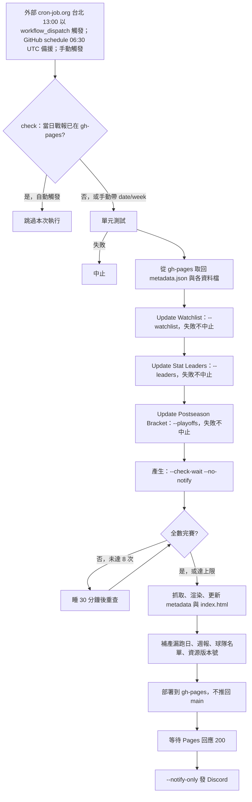

# 專案架構 (Project Architecture)

本專案是輕量化的自動化 MLB 戰報系統：無伺服器運行、靜態網頁託管。GitHub Actions 每日執行 Python 腳本抓取資料並產生靜態 HTML，部署到 GitHub Pages，最後以 Discord Webhook 通知。只使用 Python 標準函式庫（需 Python 3.12 以上）。

---

## 檔案結構

```
fetch_mlb.py              薄入口（重新匯出 mlb_daily 內所有名稱，CLI 不變）
mlb_daily/                主程式套件（config、timeutil、net、htmlutil、storage、transactions、news、watchlist、translate、games、standings、leaders、playoffs、previews、rosters、team_page、report、weekly、index_page、notify、cli）
settings/watchlist.json   台日韓球員中文名／別名覆寫與 exclude_ids（納入版控）；動態名單為 data/watchlist.json（--watchlist 產生，不入版控）
settings/offseason_calendar.json   休賽季重要日程（手動維護，週報頁尾「下週日程」用；納入版控，目前為空檔）
templates/report.html     戰報與休賽季快報頁面骨架
templates/index.html      首頁骨架
templates/weekly.html     休賽季每週總整理頁面骨架
templates/leaders.html    數據排行頁骨架
templates/playoffs.html   季後賽對戰樹頁骨架
以下 `site/` 為網站根目錄（部署時只發佈此資料夾，線上網址不含 `site`）；標註「產生」者不進 main，由 `.gitignore` 的 `/site/index.html`、`/site/leaders.html`、`/site/playoffs.html`、`/site/reports/`、`/site/data/` 忽略，僅存在於 gh-pages。
site/assets/style.css          共用樣式表
site/assets/archive.js         歷史存檔頁腳本
site/assets/teams.js           球隊專頁腳本（球隊摘要、近期動態、隊內數據王、名單）
site/teams.html                球隊專頁（執行時以 JS 讀取 data/teams/*.json）
site/archive.html              歷史存檔頁（靜態檔，執行時以 JS 讀取 metadata）
site/index.html                首頁（腳本全量重新產生；產生）
site/leaders.html／site/playoffs.html   數據排行頁與季後賽對戰樹頁（產生）
site/data/teams/               名單 JSON（產生）
site/data/leaders.json         數據排行榜資料（產生）
site/data/playoffs.json        季後賽對戰樹資料（產生）
site/data/daily/YYYY-MM-DD.json   每日資料快照（已翻譯的大聯盟異動與新聞，供週報使用；產生）
site/reports/metadata.json     每日索引（產生，workflow 先取回）
site/reports/weekly/YYYY-Www.html 休賽季每週總整理（產生）
site/reports/weekly/index.json    週報索引（產生，workflow 先取回）
site/reports/YYYY/MM/YYYY-MM-DD.html   戰報（產生）
tests/test_fetch_mlb.py   單元測試
tests/test_watchlist.py   台日韓球員專區測試
tests/test_weekly.py      休賽季每週總整理測試
tests/test_leaders.py     數據排行榜測試
tests/test_playoffs.py    季後賽對戰樹測試
tests/fixtures/           API 假資料（schedule、boxscore、content、transactions、RSS）；daily_snapshots/ 為週報用的每日快照、offseason_calendar_test.json 為日程設定；leaders_*.json、sabermetrics_*.json 為排行榜；postseason_series_2026.json 為 2026 季後賽系列賽真實回應
.github/workflows/daily_report.yml   排程、測試、部署、通知
```

---

## 流程



1. **觸發**：主要由外部 cron-job.org 於台北時間 13:00 以 `workflow_dispatch` 觸發；GitHub schedule（`cron: '30 6 * * *'`，即 06:30 UTC、台北 14:30）僅作備援，刻意排在主排程之後。當日戰報已存在於 gh-pages 時，自動觸發由 `check` job 跳過，避免重複產生與通知（手動帶 `date` 或 `week` 時不跳過）。此外，`schedule` 事件若在台北時間 13 點前執行（備援排程被 GitHub 延遲跨過台北午夜時，日期會算錯一天、提前產報）也由 `check` job 跳過；`workflow_dispatch` 不受影響。`workflow_dispatch` 輸入：`date`（報表日期 YYYY-MM-DD，留空為台北時間昨日）、`notify`（是否發 Discord，預設 false）、`week`（手動補產指定週的休賽季每週總整理，ISO 週 YYYY-Www，例 2026-W47；留空則依排程規則，週一且休賽季才產生）。`concurrency` 群組 `daily-report`（不取消進行中），job `timeout-minutes: 330`。
2. **測試**：`python -m unittest discover -s tests -v`。
3. **產生**：`python fetch_mlb.py --check-wait --no-notify --date <日期>`，環境變數帶入 `GEMINI_API_KEY`。
4. **更新名單**：`python fetch_mlb.py --rosters`（`continue-on-error: true`），見「球隊專頁」一節。
5. **歷史只在 gh-pages**：`index.html` 與 `reports/metadata.json` 不進 main；workflow 在產生報表前先從 gh-pages 取回 `metadata.json`（取不到或非 JSON 物件即失敗），產生後隨 gh-pages 部署。
6. **部署**：`peaceiris/actions-gh-pages@v4`，`publish_dir: ./site`、`keep_files: true`。只發佈 `site/`，程式、模板、文件、設定都不在其中，所以不需要 `exclude_assets`；`site/` 內不得放 `.gitignore`，否則其規則會讓新戰報不被部署。gh-pages 上的檔案布局與網址維持原樣（`site/` 的內容即 gh-pages 根目錄）。
6a. **資源版本號**：部署前執行 `python -m mlb_daily.stamp_assets site "${GITHUB_SHA::7}"`，把 `site/` 內 HTML 引用的本站 `assets/*.js`、`assets/*.css`（含 `../assets/` 等相對路徑）加上或替換成 `?v=<commit 前 7 碼>`，避免瀏覽器快取舊版 JS／CSS 搭配新資料。只改 runner 工作目錄、不 commit 回 main，repo 內原始 HTML／模板不含版本號；略過 `docs`、`templates`、`tests` 等不部署的目錄；外部網址不動。gh-pages 上只靠 `keep_files` 保留的舊戰報不在本次處理範圍，仍引用無版本號的資源（下次重產時才會更新）。
7. **等待 Pages**：每 15 秒檢查當日戰報網址，最多 20 次（約 5 分鐘），逾時只警告、仍繼續下一步。
8. **通知**：`python fetch_mlb.py --notify-only --date <日期>`，僅排程觸發或手動勾選 `notify` 時執行。
9. **每週總整理**（休賽季，見「休賽季每週總整理」一節）：Restore 步驟額外還原 `data/daily/` 與 `reports/weekly/index.json`；`Generate Weekly Report`（`continue-on-error: true`）緊接在 Generate Daily Report 之後；部署後若本次有產生週報，另有「等待週報網址 200」與「`--notify-weekly`」兩個步驟（條件同每日通知）。`workflow_dispatch` 新增 `week` 輸入（手動補產指定週）。
10. **數據排行榜**（見「數據排行榜」一節）：Restore 步驟額外還原 `data/leaders.json`（取不到只警告）；`Update Stat Leaders`（`python fetch_mlb.py --leaders`，`continue-on-error: true`）在 Generate Daily Report 之前執行。
11. **季後賽對戰樹**（見「季後賽對戰樹」一節）：Restore 步驟額外還原 `data/playoffs.json`（取不到只警告）；`Update Postseason Bracket`（`python fetch_mlb.py --playoffs`，`continue-on-error: true`）緊接在 Update Stat Leaders 之後。
12. **台日韓動態名單**（見「台日韓球員專區」一節）：Restore 步驟額外還原 `data/watchlist.json`（取不到只警告）；`Update Tracked Players Watchlist`（`python fetch_mlb.py --watchlist`，`continue-on-error: true`）在 Update Stat Leaders 之前執行。

---

## `mlb_daily/` 模組與相依方向

`fetch_mlb.py` 是薄入口：UTF-8 reconfigure、重新匯出原本所有名稱、呼叫 `main`。實際程式在 `mlb_daily/`，由下而上相依（下層不得 import 上層）：

`config`／`timeutil` → `net`／`htmlutil`／`storage` → `transactions`／`news`／`watchlist` → `translate`／`games`／`standings`／`leaders`／`playoffs`／`previews`／`rosters` → `team_page`（可用 `weekly`、`standings`、`playoffs`、`watchlist`、`storage`；由 `cli` 傳給 `rosters`） → `report`／`weekly`／`index_page`／`notify` → `cli`

`weekly` 與 `report` 同層：可用 `transactions`、`news`、`watchlist`、`rosters`、`htmlutil`、`storage`、`timeutil`、`config`，**不得** import `report`／`index_page`／`notify`／`cli`。首頁與通知需要週報資料時，由 `index_page`／`notify`／`cli` 透過 `storage.load_weekly_index`／`latest_weekly_entry` 讀 `reports/weekly/index.json`，不 import `weekly`。

| 模組 | 內容 |
| --- | --- |
| `config` | 常數、URL 模板、`_UNSET` |
| `timeutil` | 台北時間與日期格式 |
| `net` | `fetch_json`／`fetch_text`（重試 3 次，失敗回傳 `None`）、`post_json`、`ApiError`、`LAST_POST` |
| `htmlutil` | `esc()`（所有外部字串輸出到 HTML 前一律經過）、顏色、`logo_picture`、`player_link`、模板與 `fill_slots`、`_section_message` |
| `storage` | `load_metadata`／`save_metadata`、`write_report`、`write_json_atomic`；週報相關：`write_daily_snapshot`、`write_weekly_report`、`load_weekly_index`／`save_weekly_index`／`latest_weekly_entry` |
| `transactions` | 人事異動篩選與渲染、`split_game_transactions`、每週異動 |
| `analysis` | `fetch_daily_analysis`（FanGraphs RSS 深度分析）與 `render_analysis_section` |
| `news` | `fetch_daily_news`（MLB.com RSS）、`fetch_game_news`（單場 content）與渲染 |
| `watchlist` | 台日韓球員專區：從 MLB API 抓動態名單、合併 settings 覆寫、比對異動／新聞／boxscore、組成 `spotlight` 資料與渲染（只依賴 `config`、`htmlutil`、`net`、`storage`、`timeutil`） |
| `translate` | Gemini 翻譯、`apply_translations`、`LAST_TRANSLATION`、`TX_TRANSLATION_CACHE`、`translate_weekly_transactions` |
| `games` | `check_all_games_finalized`（API 失敗拋 `ApiError`，只有 `totalGames == 0` 才視為無賽事）、`classify_game_status`、焦點球員評分、決定、比賽卡片與 view、摘要句 |
| `standings` | 戰績側欄（`render_standings_aside` 的 `extra_html` 可接首頁小卡 HTML，不 import `leaders`） |
| `leaders` | 數據排行榜（與 `standings` 同層，賽季與是否賽季中由 `cli` 傳入）：`fetch_leaders`（5 個請求）、`generate_leaders`（寫 `site/data/leaders.json` 與 `site/leaders.html`，12 項全失敗不覆寫）、`render_leaders_page`（`templates/leaders.html`）、`render_leaders_card`（首頁側欄小卡，`index_page` 讀 `storage.load_leaders` 後渲染） |
| `playoffs` | 季後賽對戰樹（與 `leaders` 同層，只依賴 `config`、`timeutil`、`net`、`htmlutil`、`storage`）：`fetch_postseason`（單一請求）、`parse_postseason`（純函式，含 `feedsInto`／`byeIds`）、`generate_playoffs`（寫 `site/data/playoffs.json` 與 `site/playoffs.html`，抓取失敗不覆寫）、`render_playoffs_page`（`templates/playoffs.html`）、`render_playoffs_card`（首頁側欄小卡，`index_page` 讀 `storage.load_playoffs` 後渲染） |
| `previews` | 賽事預告、先發投手、開季倒數 |
| `rosters` | 球隊專頁（`--rosters`）；`fetch_rosters(today, extras_factory)` 可把球隊專頁附加資料併入各隊 JSON |
| `team_page` | 球隊專頁附加資料：`compute_leaders`（隊內數據王）、`build_recent`（近 30 天動態）、`postseason_result`、`build_record`、`tracked_names`、`make_extras`（`cli` 的 `--rosters` 傳給 `fetch_rosters`） |
| `report` | `render_report`（賽季戰報與休賽季快報共用）、`generate_report`、`generate_offseason_report`；兩條流程結束時各寫一份每日快照（`build_daily_snapshot`） |
| `weekly` | 休賽季每週總整理：週次計算、讀每日快照、分類、各隊動態、新聞精選、下週日程、渲染 `templates/weekly.html`、`generate_weekly_report` |
| `index_page` | 首頁附加資訊、`_safe_call`、`update_index_page`、`refresh_index_page`（不新增 metadata 只重產首頁）、休賽季區塊的最新週報連結 |
| `notify` | `should_notify`、`send_discord_notification`、`send_weekly_notification` |
| `cli` | `main`（argparse 與流程控制）；`--weekly`／`--notify-weekly` 分支 |

資料流：抓取（`net`、`games`、`news`、`transactions`）→ 資料抽取與 view（`games`）→ 翻譯（`translate`，渲染前）→ 渲染（`report`、`index_page`）→ 輸出與通知（`storage`、`notify`）。每日戰報輸出後另存 `data/daily/YYYY-MM-DD.json`；週報（`weekly`）只讀這些快照，不抓 API、不翻譯。

### 模板插槽

`templates/report.html` 的插槽：`TITLE`、`DATE_LONG`、`SUBTITLE`、`SUMMARY`、`SEARCH`、`SPOTLIGHT`、`NEWS`、`GAMES`、`TRANSACTIONS`、`GENERATED_AT`。`templates/index.html` 的插槽：`LATEST`、`SPOTLIGHT`、`RECENT`（另有 `UPCOMING`、`TEAMS`、`STANDINGS`、`STANDINGS_UI`）。`templates/weekly.html` 的插槽：`TITLE`、`DATELINE`、`SUMMARY`、`HIGHLIGHTS`、`WATCH`、`CATEGORIES`、`TEAMS`、`NEWS`、`CALENDAR`、`GENERATED_AT`。插槽格式為 `<!--SLOT:NAME-->`，`fill_slots` 單次掃描替換，插入的內容不會被當成插槽再次展開。

### 共用資源與連結

CSS 一律放在 `assets/style.css`，不內嵌在各頁。戰報頁位於 `reports/YYYY/MM/`，以 `../../../assets/style.css`、`../../../index.html`、`../../../archive.html` 相對連結回到網站根目錄（即 `site/`；網站內連結一律相對於網站根目錄，不含 `site/`）；週報頁位於 `reports/weekly/`，用 `../../assets/style.css` 等兩層相對連結；首頁使用 `assets/style.css`、`archive.html`。

---

## metadata 欄位

`reports/metadata.json` 是以日期為鍵的物件，每筆：

| 欄位 | 說明 |
|---|---|
| `date` | `YYYY-MM-DD` |
| `total_games` | 總場數（休賽季為 0） |
| `postponed` | 延賽與取消場數 |
| `summary` | 純文字摘要（輸出時才 escape） |
| `type` | `season` 或 `offseason` |
| `news_count` | 當日新聞則數；新聞抓取失敗時不寫入此欄 |
| `transactions_count` | 該頁顯示的人事異動筆數 |
| `translated` | 本頁是否成功套用翻譯 |
| `spotlight` | 台日韓球員專區條目清單，只在當日有內容時寫入（格式見下） |

`spotlight` 每筆皆為純文字（渲染時才 `esc()`），共通欄位 `player_id`、`kind`、`date`：

- `transaction`：`text`（譯文或英文原文）、`persons`（`[{id, name}]`，供替英文名加 Savant 連結）、`to_team_id`、`from_team_id`（供休賽季推算球隊）、選填 `also_player_ids`。
- `news`：`text`（標題）、`link`、選填 `also_player_ids`。
- `game`：`batting`、`pitching`（文字或 null）、`team_id`（boxscore 所屬球隊）。

一則異動或新聞涉及多位名單球員時只存一次，歸第一位球員，其餘球員放 `also_player_ids`，渲染時在其分組顯示「（同上則異動）」或「（同上則新聞）」。

舊資料缺少 `type`／`news_count` 等欄位時，首頁與存檔頁會以 `total_games` 推斷類型，缺欄位則省略該數字。

`summary` 規則：

- 賽季：「昨日共進行了 N 場賽事。」＋延賽數＋焦點最突出的 3 場一句話摘要（每場取該場焦點球員的最高 `norm`；無 boxscore 的場次排在最後，同分維持賽程順序）。

焦點球員（`games.py`，權重與門檻皆為模組層級常數）以單場為單位、兩隊合併，打者與投手分開評分與入選：

- 打者分數 = TB + BB + HBP + SB − CS + 0.5×(R + RBI) − 0.25×(AB − H)；TB 優先用 `totalBases`，缺少時用 H + 2B + 2×3B + 3×HR。資格：有打數、盜壘或得分。入選：依分數排序最多 4 人，前 2 名分數 ≥ 3，第 3 名起須 ≥ 5。
- 投手分數 = 2×出局數 + K − 2×BB − 2×H − 3×R − 6×HR（R 為總失分，非自責分）；後援（非先發，先發為 `pitchers[0]`）0 失分且救援或中繼成功再 +2，勝投不加分。資格：有局數且不是 `0.0`。入選：依分數排序最多 3 人，第 1 名分數 ≥ 8，其餘先發 ≥ 20、後援 ≥ 10。
- 每位入選者附 `norm` = 分數 ÷ 門檻（打者 5、先發 20、後援 10）；`selected` 依 `norm` 由高到低排序，`selected[0]` 為本場最突出球員，`top_focus_score` 回傳 `max(norm)`（無入選者為 0）。卡片內打者、投手兩區塊各依原始分數排列。
- 休賽季：當日新聞前 3 則標題（已翻譯用譯文）以「；」連接；無新聞時為「休賽季：人事異動 N 筆」；兩者皆無為「休賽季，無重大消息」。

---

## 錯誤處理策略

- **H1 API 失敗不等於無賽事**：`check_all_games_finalized` 失敗拋出 `ApiError`。單次檢查直接 `exit 1`；`--check-wait` 中視為未完成並重試，用完次數仍從未取得賽程則 `exit 1`。失敗時不寫任何檔案。
- **M3 boxscore 失敗**：該場改用 schedule 資料的簡化卡片（標示「詳細數據暫缺」），卡片總數仍等於總場數。
- **M5 metadata 讀寫失敗**：讀取或解析失敗 `exit 1`，不覆寫原檔；寫入使用暫存檔加 `os.replace`，失敗 `exit` 非零。
- **新聞或翻譯失敗**：新聞抓取失敗則省略該區塊且不寫 `news_count`；翻譯失敗退回原文，不影響整體結果。
- **外部字串**：新聞、球員名、隊名、人事異動、`data-teams` 一律經 `esc()`；新聞連結與圖片只接受 https 且主機為 `www.mlb.com` 或 `*.mlbstatic.com`。

### 等待機制

`--check-wait` 最多檢查 `--max-wait-checks` 次（預設 8），每次未完成睡 30 分鐘。Suspended（暫停比賽）不視為未完成，不等待。達上限後仍有未完成場次，照常產出戰報並標示「未完賽」。Postponed、Cancelled 視為已結束。

---

## 資料規格與篩選

### 賽事狀態與文案

- 延賽與取消分開呈現；原因分別對照 `POSTPONED_REASONS`、`CANCELLED_REASONS`，未知原因以「賽事取消（原因：…）」呈現。
- 卡片標題依 `gameType` 顯示例行賽、外卡賽、分區系列賽、聯盟冠軍賽、世界大賽、春訓、熱身賽、明星賽，其他為「比賽」。
- Suspended 兩隊都不標勝方。

### 傑出表現球員

不分隊伍，前 3 名保證入選，第 4 名起達門檻才加列：

- 打者積分：`H + 2B*2 + 3B*3 + HR*4 + RBI*1.5 + R + SB + BB`，門檻 7.0。沒有打數但有盜壘或得分的代跑者也列入候選。
- 投手積分：`出局數（IP×3） + SO - ER*2 - H - BB + 勝投 5 + 救援 4`，門檻：先發 15.0、後援 8.0。
- 打者顯示 AB、R、H、RBI、BB、SO，加上 2B／3B／HR／SB 的「單場次數(賽季累計)」標記，如 `HR: 2(10)(11)`；賽季累計缺漏或小於單場次數時只顯示次數。
- 投手顯示 IP、H、R、ER、BB、SO、P-S。

### 人事異動

來源 `transactions?date=...&sportId=1`，保留條件：

1. 不含 `minor league`。
2. 含 `signed` 者須有大聯盟特徵詞（`free agent`、`major league`、`extension`、`arbitration`、`-year`）。
3. `toTeam` 或 `fromTeam` 至少一方為 30 支大聯盟球隊之一（排除小聯盟球隊之間與冬季聯盟指派）。
4. 相同描述合併為一筆：API 對一筆交易的每位球員各回一筆紀錄（description 相同、toTeam／fromTeam 方向各異，另有 person 為 null 的現金／PTBNL 紀錄），先依描述分組再整組過濾；第 3 點改為「整組任一紀錄」涉及 30 隊即可。合併後 `to_team_id`／`from_team_id`／`person_*` 取第一筆涉及 30 隊的紀錄，`persons` 收全部球員，另有 `legs`（每筆紀錄的 `{to_team_id, from_team_id, person_id}`，去重）與 `team_ids`（legs 中出現過的球隊 id，去重，不限 30 隊）；舊資料沒有 `team_ids` 時用 `tx_team_ids()` 退回 `[to_team_id, from_team_id]`。

比賽球隊的異動放進該場卡片（兩隊任一在 `team_ids` 內即算相關），其餘放在頁尾「其他球隊人事異動」。頁尾依球隊分組時，多隊交易在 `team_ids` 的每支 30 隊分組都列出（同組只出現一次；標題筆數仍為異動筆數）；都不是 30 隊才進「其他異動」；休賽季頁面標題為「大聯盟人事異動」。描述先 escape，再把球員姓名替換成 Savant 連結（`https://baseballsavant.mlb.com/savant-player/{playerId}`）。

### 新聞

- 每日新聞：MLB.com RSS（`https://www.mlb.com/feeds/news/rss.xml`），取台北時間該日 00:00–24:00 發布者，新到舊，最多 12 則。賽季頁附在戰報上方；休賽季頁第一則為頭條。
- 深度分析：FanGraphs RSS（`https://blogs.fangraphs.com/feed/`，`mlb_daily/analysis.py`），取台北時間該日發布者，新到舊，最多 6 則；濾掉 podcast（標題以 Effectively Wild 開頭，或 category 為 Podcasts／Effectively Wild）；link 須為 https 且主機為 `blogs.fangraphs.com`、`www.fangraphs.com` 或 `fangraphs.com`，否則整則捨棄。顯示於「今日新聞」下方（`ANALYSIS` 插槽，賽季與休賽季頁皆有），顯示標題（翻譯成中文）與「FanGraphs · 作者」，不顯示圖片與時間；抓取失敗或當日無文章時整個區塊不顯示。標題與新聞同一批送翻譯。目前不寫入每日快照、週報、球隊專頁或台日韓名單比對。
- 單場賽後新聞：`game/{gamePk}/content` 的 recap headline 與 blurb；缺漏時用比分備份文字（不翻譯）。

---

## 翻譯流程（Gemini）

- 以 `urllib` 直接呼叫 Gemini Interactions API，不安裝 SDK；金鑰讀環境變數 `GEMINI_API_KEY`，模型可由 `GEMINI_MODEL` 覆寫。
- 範圍：RSS 新聞標題、FanGraphs 深度分析標題、單場賽後新聞的 Headline／Blurb、人事異動描述。球員姓名逐字保留英文，數據縮寫保留，球隊名稱依內建對照表。
- 整頁先收集所有文字，一次送翻（超過 60 則分批）；每則附 `keep` 清單，譯文必須逐字包含其中字串，否則該則退回原文。
- 退回原文的情況：無金鑰、無內容、整批失敗（HTTP 錯誤、非 JSON、長度不符）。結果寫入 `translated`。
- 譯文先寫入 `*_zh` 欄位，渲染時優先使用譯文；球員超連結在譯文出爐後才用英文姓名比對替換。
- 錯誤訊息會遮蔽金鑰後才輸出。
- 重試：HTTP 429／500／502／503／504 與逾時、連線錯誤最多共嘗試 4 次（間隔 5、15、45 秒，尊重數字型 `Retry-After`，上限 120 秒）；其他 4xx 不重試。
- 備用模型：主模型因上述可重試錯誤耗盡仍失敗時，改用 `GEMINI_FALLBACK_MODEL`（預設 `gemini-3.6-flash`，設為空字串則停用；與主模型相同不重複），備用模型同樣有重試；400／401／403／404 不改用備用模型。

---

## 通知

`send_discord_notification` 由 `--notify-only` 呼叫，讀 `reports/metadata.json` 中該日資料，不呼叫 MLB API。賽季通知含總場數、延賽數、焦點摘要與新聞則數；休賽季通知含新聞與人事異動數。`should_notify`：休賽季快報在新聞與人事異動皆為 0 時不發。未設定 `DISCORD_WEBHOOK_URL` 時略過並印出警告。

週報另有獨立訊息：`--notify-weekly`（可加 `--week YYYY-Www`，預設最新一週）讀 `reports/weekly/index.json`，`send_weekly_notification` 發一則 embed（標題、日期範圍、交易／簽約筆數、資料涵蓋天數、連結），網址基底 `SITE_BASE_URL`（`https://haolun588.github.io/MLB-daily/`，與每日戰報通知相同）。只有本次執行確實產生週報時才發（workflow 以 `Generate Weekly Report` 的 step output 控制）。

---

## 首頁與存檔

- `index.html` 每次由 `templates/index.html` 與 metadata 全量產生：最新一期大卡＋近期 6 期（不含最新一期），休賽季項目顯示新聞與人事異動數量。
- `archive.html`＋`assets/archive.js`：讀取 `reports/metadata.json` 依月份分組；讀取失敗顯示錯誤訊息；所有外部資料以 `textContent` 寫入，不拼接 HTML。另讀 `reports/weekly/index.json`，在頁面最上方加「每週總整理」清單（讀不到、格式不符或沒有週報就不顯示；週次須符合 `YYYY-Www` 才組連結）。
- 首頁休賽季區塊（`UPCOMING` 插槽，賽季中不顯示）加「每週總整理：最新週報」連結卡，讀 `reports/weekly/index.json` 最新一週，連結由週次組出（不信任索引內的 path）；該週 `end` 距今超過 14 天不顯示。週報產生後 CLI 呼叫 `refresh_index_page()` 讓首頁立即更新（metadata 不存在時略過）。

---

## 球隊專頁

`python fetch_mlb.py --rosters`（可搭配 `--date` 指定「今天」，不可與 `--notify-only`、`--check-wait` 併用）：不產生戰報、不動 metadata、不發通知。

### 資料流程

1. `resolve_roster_context(today)` 判斷名單類型與數據賽季。
2. 對 `TEAM_META` 的 30 隊逐隊呼叫 `teams/{id}/roster?rosterType=...&season=...&hydrate=person(stats(type=[season,sabermetrics],group=[hitting,pitching],season=...))`，每隊間隔 0.5 秒。
3. `build_team_players` 精簡成球員清單，以 `write_json_atomic`（暫存檔加 `os.replace`）寫入 `data/teams/{id}.json`，最後寫 `data/teams/index.json`。
4. 單隊失敗保留舊檔且在 index 標 `ok: false`，其餘隊照常；至少一隊成功才 `exit 0`，全數失敗 `exit 1`（workflow 以 `continue-on-error` 吸收）。
5. `site/data/` 被 `.gitignore` 忽略（不進 main），由 gh-pages 部署帶出。

### 名單類型與數據賽季

依 `GET /api/v1/seasons/{year}?sportId=1` 的 `regularSeasonStartDate` 至 `postSeasonEndDate`（缺則用 `seasonEndDate`）：

| 時間 | rosterType | 數據賽季 |
|---|---|---|
| 賽季期間 | `active`（26 人） | 當年 |
| 開季前 | `40Man` | 前一年 |
| 季後（含休賽季） | `40Man` | 當年（剛結束的球季） |

賽季 API 失敗時以月份推估（4–10 月 active；11–12 月 40Man 當年；1–3 月 40Man 前一年）並印 warning。

### JSON 結構

`index.json`：`updatedAt`、`rosterType`、`season`、`teams`（每隊 `id`、`abbr`、`name`、`color`、`league`、`division`、`ok`，成功者另有 `updatedAt`）。

`{id}.json`（`summary`、`recent`、`leaders` 為球隊專頁附加資料，見「球隊專頁」一節；任一區塊產生失敗時該欄缺席，前端降級）：
- `meta`：`id`、`abbr`、`name`、`rosterType`、`season`、`updatedAt`。
- `players`：每人 `id`、`name`、`number`、`pos`（API 原始位置代號）、`group`（`SP`／`RP`／`POS`）、`hitting`、`pitching`；二刀流（`TWP`）另有 `pitchingGroup`。
  - `hitting`：`g`、`pa`、`avg`、`obp`、`slg`、`hr`、`sb`、`bbPct`、`kPct`、`wrcPlus`、`war`。
  - `pitching`：`g`、`gs`、`ip`、`w`、`l`、`sv`、`hld`、`era`、`whip`、`so`、`k9`、`fip`、`war`。
  - 無數據為 `null`；BB% = BB／PA、K% = SO／PA 由程式計算；交易球員取全季合計。

### 分組規則

- 投手（`pos == P`）：本季 `gs / g >= 0.5` 為 `SP`，其餘（含無數據）為 `RP`。
- 野手與二刀流：`group` 皆為 `POS`，在野手表顯示（守位欄）；`TWP` 另以 `pitchingGroup` 進入對應的 SP／RP 表。

---

## 球隊專頁

`teams.html` 由上而下四個區塊：球隊摘要、近期動態（近 30 天）、隊內數據王、名單（SP／RP／野手三張表與慣用手標籤，維持原樣）。附加資料由 `--rosters` 流程以 `team_page.make_extras(today, ctx)` 產生並寫入各隊 `{id}.json`（`fetch_rosters` 的 `extras_factory`），不新增獨立 CLI 或 workflow 步驟。

| 欄位 | 內容與來源 |
|---|---|
| `summary.record` | `w`、`l`、`pct`、`divRank`、`rd`（得失分差）；`standings.fetch_standings(season)`（多一個請求；失敗為 `null`） |
| `summary.postseason` | `{text, outcome}`（`champion`／`eliminated`／`active`／`missed`）；讀 `data/playoffs.json`，其 `season` 與名單數據賽季相同才採用，否則 `null`（賽季中前端不顯示該行） |
| `summary.tracked` | 物件清單：先列該隊名單上的追蹤球員 `{name}`，再列母隊（`org_id`）為該隊、不在名單上、目前在小聯盟的台灣球員 `{name, level}`（層級 AAA→AA→A+→A→ROK，再依英文名）；前端也相容舊的字串元素，小聯盟球員以灰色標籤加層級小字顯示 |
| `recent.moves` | 讀 `data/daily/*.json` 報表日（執行日前一天）起往前 30 天，且異動日期須落在窗口內；相關新聞比對：英文城市＋暱稱全名不分大小寫，單獨暱稱與口語簡稱分大小寫整詞並排除日韓球團前綴（`config.NON_MLB_TEAM_PREFIXES`），中文只比對全名，沿用 `weekly` 的分類與 `team_moves`（交易雙方各記一次、DFA／釋出為離開）：`date`、`dir`（`in`／`out`）、`player`、`type`、`note`（譯文，缺則原文）；傷兵名單等未列入週報分類的異動不顯示 |
| `recent.news` | 同樣讀每日快照，以中英文隊名、暱稱與口語簡稱比對標題與摘要（英文整詞、中文子字串），依 link 去重、新到舊最多 5 則；只收 http(s) 連結；來源固定 `MLB.com` |
| `recent.snapshotDays` | 窗口內實際讀到的快照檔數；為 0 時前端顯示「尚無近期資料」而非「沒有異動」 |
| `leaders` | 打擊 AVG／HR／OPS／SB／WAR、投球 ERA／SO／SV／WHIP／WAR 各一名；AVG、OPS 需 300 打席，ERA、WHIP 需 50 局，HR／SB／SO／SV 需大於 0，同值依 PA／IP 多者、再球員 id 小者；無人達標 `id`／`name`／`value` 為 `null`；`thresholds` 同時寫入（常數在 `config.TEAM_PAGE_*`） |

`data/daily/` 與 `data/playoffs.json` 只存在於 gh-pages；workflow 的「Restore history from gh-pages」步驟已還原它們，且「Update Team Rosters」在「Generate Daily Report」之後執行，所以當天快照也讀得到。讀不到、缺天或損壞的快照略過（`weekly.load_week_snapshots`），任何來源失敗只影響對應欄位，名單照寫。名單頁副標依 `rosterType` 顯示「26 人現役名單」或「40 人名單」；摘要右上角標籤：休賽季「YYYY 賽季最終」，賽季中「截至 M/D」。

---

## 台日韓球員專區

- **名單來源**：動態名單 + 本地覆寫。`python fetch_mlb.py --watchlist [--date]`（不可與其他模式併用）呼叫 `/sports/{sportId}/players?season=`：sportId=1（大聯盟）收 `birthCountry` 為 Taiwan／Japan／Republic of Korea（容錯 South Korea、Korea）的球員，region 為 `TW`／`JP`／`KR`；小聯盟（11=AAA、12=AA、13=A+、14=A、16=ROK）只收 Taiwan。依 id 去重並記錄最高層級 `level`（MLB > AAA > AA > A+ > A > ROK）。另抓一次 `/teams?sportIds=11,12,13,14,16&season=` 建立附屬隊 → (母隊 `parentOrgId`、層級) 對照，每位球員存 `org_id`（母隊 MLB id）與 `current_level`（currentTeam 所在層級，30 隊之一為 MLB；對不到或 teams 端點失敗為 null）。單一 sportId 失敗或回傳空陣列時警告，並沿用舊 `data/watchlist.json` 中該層級的球員（新資料有同 id 者以新資料為準，印出沿用人數）；全部失敗不覆寫舊檔並以非 0 結束。球季沿用 `rosters.resolve_roster_context`。結果寫 `data/watchlist.json`：`{"updatedAt","season","players":[{id,name_en,region,level,org_id,current_level}],"missing_zh":[...]}`；`missing_zh` 為沒有中文名對照的球員，執行時也會印出（id、英文名、層級、region），方便補進 settings。
- **本地覆寫**：`settings/watchlist.json`（納入版控；`data/` 被忽略，`settings/` 不在發佈目錄 `site/` 內，不會部署）。格式 `{"exclude_ids": [], "players": [{"id", "name_zh", "name_en", "region", "aliases"?}]}`：`players` 提供中文名與別名（姓氏常見如 Lee、Kim 者不要加姓氏），其欄位覆寫動態值，也可補入 API 抓不到的球員（例如海外出生的台日韓球員）；`exclude_ids` 手動排除（例如出生地是台灣但非台灣籍）。
- **讀取與合併**：`load_watchlist(path=None, dynamic_path=None)` 合併動態快取與 settings 後移除 `exclude_ids`，回傳 `{person id: {id, name_zh, name_en, region, aliases, level, org_id, current_level, has_zh}}`；沒有中文名時 `name_zh` 填 `name_en`、`has_zh` 為 False，`level` 可為 None（settings 獨有的球員）。排序：地區（台→日→韓）→ settings 內球員依檔案順序 → 其餘依層級再依英文名。動態快取缺失或損毀：印警告、只用 settings；settings 讀檔失敗、JSON 錯誤或格式不符：印警告、視為空名單、專區不顯示，不中斷執行；個別格式錯誤的球員略過。明確傳 `path` 而未傳 `dynamic_path` 時不讀動態快取（供測試）。
- **workflow**：Restore 步驟額外還原 `data/watchlist.json`（取不到只警告）；`Update Tracked Players Watchlist`（`--watchlist`，`continue-on-error: true`）在 `--leaders` 之前執行，失敗時沿用上次結果；`data/watchlist.json` 與 `data/leaders.json` 相同，只存在 gh-pages。
- **補中文名／新增球員**：在 settings 的 `players` 加一筆（id 可由 `--watchlist` 的缺中文名清單取得，或用 `statsapi.mlb.com/api/v1/people/search` 查），不需改程式。
- **比對**：異動用未經大聯盟過濾的原始資料（含小聯盟），比對 `person.id`；多人交易依相同描述合併。新聞用當日全部 RSS（不受顯示上限 12 則限制），比對標題與 `<description>` 純文字，整詞、不分大小寫，只比對 `name_en` 與 `aliases`。boxscore 用當日已抓資料，依 `ID{personId}` 取成績，不重抓。
- **成績列**：打擊列需有打席（`plateAppearances` 或 `atBats` > 0）；投球列需有投球局數、`battersFaced` 或 `numberOfPitches` 任一大於 0（0 局失分也顯示）。0 的項目省略，打數與安打一定顯示。
- **顯示**：戰報區塊「台日韓球員動態」依台灣、日本、韓國再依名單順序分組；沒有內容整區隱藏。首頁顯示最新戰報日期往回 7 天（含）的 metadata `spotlight` 彙整，無內容顯示「近 7 天無台日韓球員動態。」。分組標題的球隊：優先取 boxscore 球隊，沒有則由異動的 `to_team_id`、`from_team_id` 推算（只取 30 隊之一），都沒有只顯示地區。
- **中文名例外**：分組標題用設定檔的中文名，這是「球員姓名保留英文」規則唯一的例外；異動與新聞內文仍保留英文姓名。
- **翻譯**：名單異動描述與名單新聞標題（含不在前 12 則者）併入同一批次翻譯，相同字串不重送；無金鑰顯示英文原文。

---

## 休賽季每週總整理

設計見 `docs/plans/20261118_休賽季每週總整理設計.md`。休賽季每週一（台北時間）產出 `reports/weekly/YYYY-Www.html`，彙整上一個 ISO 週（週一至週日）的人事異動與新聞；資料全部來自每日快照，不重抓 API、不重新翻譯。

### 每日資料快照 `data/daily/YYYY-MM-DD.json`

`generate_report`（有賽事）與 `generate_offseason_report`（無賽事）在翻譯完成、寫出 HTML 後各寫一份（`storage.write_daily_snapshot`，暫存檔加 `os.replace`）。寫入或組裝失敗只印警告，不影響戰報。`schema: 1`：

- `date`、`has_games`。
- `transactions`：經大聯盟過濾、戰報實際顯示的異動（賽季日含各場卡片內的），每筆 `type_code`、`date`、`description`、`description_zh`（無譯文為 `null`）、`person_id`、`person_name`、`persons`（`[{id, name}]`）、`to_team_id`、`from_team_id`、`team_ids`、`legs`（後兩者見人事異動一節；舊快照沒有，讀取端需相容。週報 `team_moves` 有 `legs` 時，`team_ids` 中每支 30 隊各記一次：任一有球員的 leg 以該隊為 to 記加入，否則記離開）。
- `news`：當天戰報實際顯示（最多 12 則）的新聞，每則 `title`、`title_zh`、`link`、`published`（ISO 字串）、`image`、`summary`（RSS 純文字，供名單比對）。新聞抓取失敗存空清單。
- 不存台日韓比對結果；週報產生時用當下的合併名單（動態快取 + `settings/watchlist.json`）重新比對。

`site/data/` 在 `.gitignore`、位於發佈目錄 `site/` 內，隨部署累積在 gh-pages；workflow 每次從 gh-pages 還原 `data/daily/`（`git archive origin/gh-pages data/daily | tar -x -C site`，失敗只警告）。

### 產生條件與 CLI

- `--weekly`：預設只在台北今天為週一，且 `resolve_roster_context(今天)["rosterType"] != "active"`（休賽季）時產生，整理「上一個」ISO 週（`今天 - isoweekday` 所在週）。`--week YYYY-Www` 手動指定週次（略過週一判斷，休賽季判斷仍套用）；`--force` 兩項都略過（不呼叫賽季 API）。`--date` 在此模式當作「今天」覆寫。
- 週次格式 `YYYY-Www`（`date.isocalendar()`、`date.fromisocalendar` 驗證；2026 年有 W53）。格式錯誤 `exit 1`。
- 讀 7 天快照；缺檔略過、損壞或 schema／日期不符的檔案印警告略過。**有 ≥1 天就照產**，頁首標示「本週資料涵蓋 N／7 天」與有／缺資料的日期；0 天不產、不通知。
- 產生後寫 `reports/weekly/index.json`（依週次去重、新的在前），CLI 印出 `weekly_week=…`、`weekly_url=…` 供 workflow 寫入 `$GITHUB_OUTPUT`，並重產首頁。
- `--notify-weekly`：見「通知」。`--weekly` 不得與 `--notify-only`／`--check-wait`／`--no-notify`／`--rosters`／`--notify-weekly` 併用；`--week`、`--force` 須搭配 `--weekly`（`--week` 也可搭配 `--notify-weekly`，`--force` 只能搭配 `--weekly`）。

### 分類（`config.WEEKLY_CATEGORIES`、`WEEKLY_TYPE_CATEGORY`）

判斷順序：描述符合 `WEEKLY_TX_EXTENSION_RE` → 延長合約（優先於 SFA）；SFA 且含 `minor league contract` → 不列入（防禦判斷）；其餘依 `type_code` 對照：`TR` 交易、`SFA` 自由球員簽約、`DES`／`REL`／`OUT` DFA／釋出／讓渡、`DFA`（Declared Free Agency）成為自由球員、`SE`／`CLW`／`R5`／`R5M` 40 人名單異動。其他（`SC`、`ASG`、`RTN`、`OPT`、`NUM`、`RET` 等）不列入。「選擇權」分類不做（API 沒有資料）。「小聯盟合約」分類已移除（審查後使用者同意）：快照內是經大聯盟過濾的異動，描述含 `minor league` 者已被排除，該分類實務上永遠為空。各隊動態方向：交易、CLW、SFA 等依 toTeam＝加入、fromTeam＝離開；離開類（DES、DFA、REL、OUT）依 fromTeam、toTeam 順序取第一個屬於 30 隊的隊伍記為離開（真實 API 中 DES／DFA／REL 只有 toTeam，OUT 的 toTeam 是小聯盟）。「本週最忙」徽章只在最高筆數 ≥ 2 時標示（並列都標）。

### 頁面內容

頁首統計（異動＝列入分類的筆數、交易、簽約＝自由球員簽約＋延長合約、資料涵蓋天數）→ 本週重點（交易、大聯盟簽約、延長合約全列，新到舊）→ 台日韓動態（沒有就不顯示）→ 分類整理→ 各隊動態（每隊分加入／離開，交易雙方都記，排除不列入，筆數最多（至少 2 筆）者可並列標「本週最忙」）→ 本週新聞精選（依 `link` 去重，台日韓球員 +2、重點異動球員 +1，同分新到舊，最多 10 則）→ 下週日程（`settings/offseason_calendar.json` 內落在下一個週一至週日的事件；檔案缺漏或格式錯誤只印警告）。異動與新聞涉及名單球員時加地區徽章（台灣／日本／韓國＋中文名）。所有外部字串經 `esc()`，新聞連結與圖片只接受 https 的 `www.mlb.com`／`*.mlbstatic.com`。

### 週報索引 `reports/weekly/index.json`

`{"weeks": [{"week", "start", "end", "days", "tx_count", "trade_count", "signing_count", "path", "generated_at"}]}`，不放進 `reports/metadata.json`。

---

## 數據排行榜

- CLI：`python fetch_mlb.py --leaders [--date]`，不可與其他模式併用；抓資料、寫 `data/leaders.json` 與 `leaders.html`，`reports/metadata.json` 存在時再重產首頁（失敗只警告）。12 項全部失敗時不覆寫舊檔並以非 0 結束。
- 資料：`/stats/leaders`（打擊 5 項、投手 4 項，必須以 `statGroup` 過濾，並列時名次相同、可能超過 10 筆）加 `stats=sabermetrics`（FIP 用 `playerPool=qualified` 升冪、打者與投手 WAR 用 `playerPool=all` 降冪，自行計算標準競賽名次）。WAR／FIP 取自 MLB 官方，頁尾註明與 fWAR／bWAR 不同。
- 賽季：沿用 `rosters.resolve_roster_context`（賽季中標題「YYYY 賽季・截至 M/D」，其餘「YYYY 賽季最終」）。
- `data/leaders.json`：`schema`、`season`、`in_season`、`as_of`、`generated_at`、`categories`（12 個 key → 名次項目陣列 `{rank,id,name,team_id,value}`，失敗為 `null`）。
- 首頁側欄戰績表下方的小卡只讀 `data/leaders.json`（無檔不顯示）；`leaders.html` 與 `data/leaders.json` 只存在 gh-pages。workflow 在每日產生前執行 `--leaders`（`continue-on-error`），並從 gh-pages 還原舊的 `data/leaders.json`。

## 季後賽對戰樹

- CLI：`python fetch_mlb.py --playoffs [--date]`，不可與其他模式併用（與 `--leaders` 互斥）；寫 `data/playoffs.json` 與 `playoffs.html`，`reports/metadata.json` 存在時再重產首頁（失敗只警告）。抓取失敗或兩年都沒資料時不覆寫舊檔並以非 0 結束。
- 資料：`/schedule/postseason/series?season=YYYY&sportId=1`，一次請求取得整屆。今年已有完賽或進行中的比賽就用今年，否則改抓去年；標題進行中為「YYYY 季後賽・截至 M/D」，完成為「YYYY 季後賽結果」。
- 勝場計算：`codedGameState == "F"`，或 `"O"`（Game Over）且 `isWinner` 已有布林值才計入；`"D"`（延賽）排除；以 `gamePk` 去重。外卡接到哪一組分區以隊伍 ID 比對（不用字母），輪空隊伍為出現在分區、但不在外卡的隊伍；`config` 對照表查不到的 id 視為待定，不參與對應與輪空判斷。
- `data/playoffs.json`：`schema`、`season`、`status`、`champion`、`rounds`（`AL`／`NL` 各有 `F`／`D`／`L`，另有 `WS`）、`asOf`、`updatedAt`；外卡系列賽多 `feedsInto`，分區系列賽多 `byeIds`。
- 頁面：桌面（≥1024px）7 欄對稱格線，樹內卡片不顯示「晉級」，輪空改在卡片標頭下方小字；手機與平板依輪次直向堆疊。兩套 DOM 以 CSS 切換。
- 首頁小卡：只讀 `data/playoffs.json`（無檔不顯示），資料賽季（`season`）與 `resolve_roster_context` 的賽季相同才顯示。`playoffs.html` 與 `data/playoffs.json` 只存在 gh-pages。

## 搜尋

賽季戰報的每張卡片帶 `data-teams`（以 `|` 分隔縮寫、中英文隊名）。搜尋框精確縮寫優先，輸入後 Enter 捲動並高亮第一筆，再按 Enter 跳到下一筆。

---

## 測試

`tests/test_fetch_mlb.py` 使用標準庫 `unittest`，所有 HTTP 由 `FakeApi` 以 `tests/fixtures/*.json` 回應（也攔截 `urlopen`），輸出導向暫存目錄，Discord 與 `time.sleep` 皆被 patch，完全不連網。涵蓋 API 失敗、無賽事、7 局雙重賽、Suspended、延長賽、boxscore 失敗、XSS、翻譯成功與失敗等。workflow 在產生戰報前先執行，失敗即中止。

### patch 定義模組與跨模組呼叫規則

- `fetch_mlb.py` 重新匯出的是原物件，patch `fetch_mlb.X` 不會影響 `mlb_daily` 內部。測試要 patch 定義該名稱的模組，例如 `mock.patch("mlb_daily.net.fetch_json")`、`mlb_daily.timeutil.get_taipei_now`、`mlb_daily.notify.send_discord_notification`。
- 直接呼叫函式與斷言內容仍可用 `fetch_mlb.X`（靠重新匯出）；`LAST_POST` 等狀態 dict 為同一物件，原地修改有效。
- 跨模組呼叫一律用模組前綴（`net.fetch_json(...)`）；`games`、`news`、`standings`、`transactions` 因與區域變數同名，以 `games_mod` 等別名匯入。只允許 `from .config import ...` 直接匯入名稱。
- 防護測試 `ImportRuleTests` 以 ast 掃描 `mlb_daily/*.py`（含 `weekly.py`），強制上述規則，且 `mlb_daily` 內不得 import `fetch_mlb`；`tests/test_weekly.py` 另驗證 `weekly` 不 import `report`／`cli`／`index_page`／`notify`。

`tests/test_weekly.py` 涵蓋休賽季每週總整理：每日快照寫入、週次與 ISO 週跨年、產生條件（週一、休賽季、`--week`、`--force`）、資料不足與損壞檔、分類、各隊動態與並列最忙、新聞精選、台日韓標註、下週日程、跳脫、週報索引與首頁連結、Discord 週報訊息、workflow 內容。fixture：`tests/fixtures/daily_snapshots/`（2026-11-16～22，缺 11-17／21、11-19 為損壞檔）、`tests/fixtures/offseason_calendar_test.json`。
