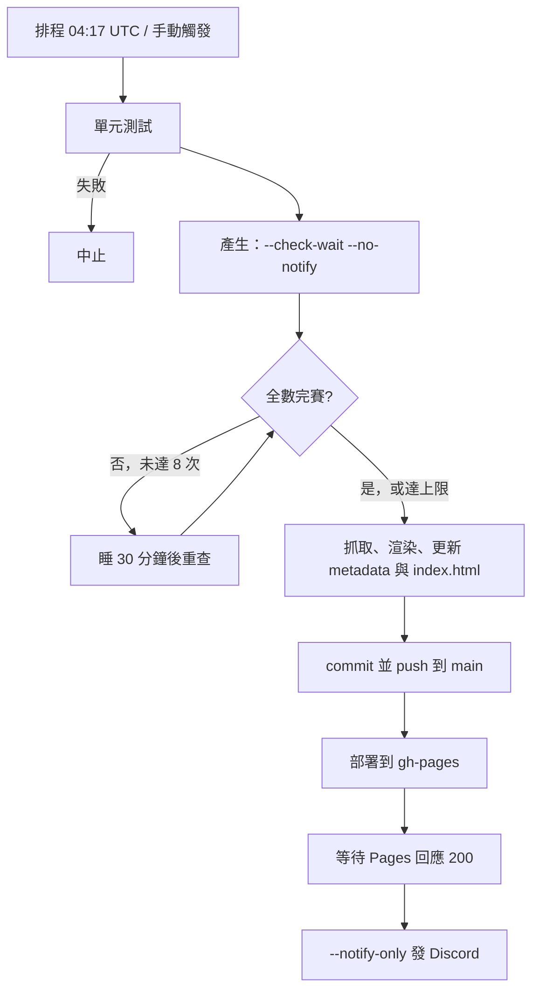

# 專案架構 (Project Architecture)

本專案是輕量化的自動化 MLB 戰報系統：無伺服器運行、靜態網頁託管。GitHub Actions 每日執行 Python 腳本抓取資料並產生靜態 HTML，部署到 GitHub Pages，最後以 Discord Webhook 通知。只使用 Python 標準函式庫（需 Python 3.12 以上）。

---

## 檔案結構

```
fetch_mlb.py              唯一的主程式
templates/report.html     戰報與休賽季快報頁面骨架
templates/index.html      首頁骨架
assets/style.css          共用樣式表
assets/archive.js         歷史存檔頁腳本
assets/teams.js           球隊名單頁腳本
teams.html                球隊名單頁（執行時以 JS 讀取 data/teams/*.json）
data/teams/               名單 JSON（僅存在於 gh-pages，main 以 .gitignore 忽略）
index.html                首頁（腳本全量重新產生，不是局部修改）
archive.html              歷史存檔頁（靜態檔，執行時以 JS 讀取 metadata）
reports/metadata.json     每日索引
reports/YYYY/MM/YYYY-MM-DD.html   戰報（僅存在於 gh-pages，main 忽略）
tests/test_fetch_mlb.py   單元測試
tests/fixtures/           API 假資料（schedule、boxscore、content、transactions、RSS）
.github/workflows/daily_report.yml   排程、測試、部署、通知
```

---

## 流程



1. **觸發**：cron `17 4 * * *`（約台北 12:17）或 `workflow_dispatch`（輸入 `date`、`notify`）。`concurrency` 群組 `daily-report`（不取消進行中），job `timeout-minutes: 330`。
2. **測試**：`python -m unittest discover -s tests -v`。
3. **產生**：`python fetch_mlb.py --check-wait --no-notify --date <日期>`，環境變數帶入 `GEMINI_API_KEY`。
4. **更新名單**：`python fetch_mlb.py --rosters`（`continue-on-error: true`），見「球隊名單」一節。
5. **push main**：只提交 `index.html` 與 `reports/metadata.json`；`git pull --rebase origin main` 後 push，失敗重試 3 次。`data/` 不進 main。
6. **部署**：`peaceiris/actions-gh-pages@v4`，`publish_dir: ./`、`keep_files: true`，`exclude_assets` 排除 `.github,.agents,docs,templates,tests,fetch_mlb.py,README.md,.gitignore,__pycache__,.claude`。必須排除 `.gitignore`，否則其中的 `reports/*/*/*.html` 規則會讓新戰報不被部署。
7. **等待 Pages**：每 15 秒檢查當日戰報網址，最多 20 次（約 5 分鐘），逾時只警告、仍繼續下一步。
8. **通知**：`python fetch_mlb.py --notify-only --date <日期>`，僅排程觸發或手動勾選 `notify` 時執行。

---

## `fetch_mlb.py` 分層

由上而下：

1. **抓取**
   - `fetch_json`／`fetch_text`：重試 3 次，失敗回傳 `None`。
   - `check_all_games_finalized(date)`：回傳 `(是否全數完賽, games)`；API 失敗或結構異常拋出 `ApiError`，只有確認 `totalGames == 0` 才視為無賽事。
   - `fetch_game_news`（單場 content）、`fetch_daily_transactions`（人事異動）、`fetch_daily_news`（MLB.com RSS）。
2. **資料抽取**
   - `classify_game_status`：Final／延長賽 `Final/N`／提前結束／Suspended／未完賽。延長賽以 `linescore.scheduledInnings` 判斷（7 局雙重賽不算延長賽）。
   - `collect_candidates`、`select_performers`：焦點球員評分與篩選（見下）。
   - `build_decisions`、`format_cumulative`、`split_game_transactions`。
3. **view（純資料 dict）**
   - `build_base_view`（狀態、隊伍、比分）、`build_game_view`（加決定與焦點球員）、`build_postponed_view`（延賽／取消）。
   - `build_summary_sentence`、`pick_summary_sentences`、`build_offseason_summary`：metadata `summary`。
4. **翻譯**（渲染前）：`apply_translations`，見下。
5. **渲染**
   - 共用工具：`esc()`（所有外部字串輸出到 HTML 前一律經過）、`fill_slots`、`render_page`。
   - 區塊：`render_summary`、`render_search`、`render_news_section`、`render_transactions_section`、`render_game_card`／`render_fallback_card`／`render_postponed_card`。
   - 整頁：`render_report(date, page_type, ...)` 為賽季戰報與休賽季快報共用；`render_index` 產生首頁。
6. **輸出與通知**：`write_report`、`load_metadata`／`save_metadata`／`update_index_page`、`should_notify`、`send_discord_notification`、`main`。

### 模板插槽

`templates/report.html` 的插槽：`TITLE`、`DATE_LONG`、`SUBTITLE`、`SUMMARY`、`SEARCH`、`NEWS`、`GAMES`、`TRANSACTIONS`、`GENERATED_AT`。`templates/index.html` 的插槽：`LATEST`、`RECENT`。插槽格式為 `<!--SLOT:NAME-->`，`fill_slots` 單次掃描替換，插入的內容不會被當成插槽再次展開。

### 共用資源與連結

CSS 一律放在 `assets/style.css`，不內嵌在各頁。戰報頁位於 `reports/YYYY/MM/`，以 `../../../assets/style.css`、`../../../index.html`、`../../../archive.html` 相對連結回到網站根目錄；首頁使用 `assets/style.css`、`archive.html`。

---

## metadata 欄位

`reports/metadata.json` 是以日期為鍵的物件，每筆：

| 欄位 | 說明 |
|---|---|
| `date` | `YYYY-MM-DD` |
| `total_games` | 總場數（休賽季為 0） |
| `postponed` | 延賽與取消場數 |
| `summary` | 純文字摘要（輸出時才 escape） |
| `type` | `season` 或 `offseason` |
| `news_count` | 當日新聞則數；新聞抓取失敗時不寫入此欄 |
| `transactions_count` | 該頁顯示的人事異動筆數 |
| `translated` | 本頁是否成功套用翻譯 |

舊資料缺少 `type`／`news_count` 等欄位時，首頁與存檔頁會以 `total_games` 推斷類型，缺欄位則省略該數字。

`summary` 規則：

- 賽季：「昨日共進行了 N 場賽事。」＋延賽數＋焦點積分最高的 3 場一句話摘要（每場取該場焦點球員的最高積分；無 boxscore 的場次排在最後，同分維持賽程順序）。
- 休賽季：當日新聞前 3 則標題（已翻譯用譯文）以「；」連接；無新聞時為「休賽季：人事異動 N 筆」；兩者皆無為「休賽季，無重大消息」。

---

## 錯誤處理策略

- **H1 API 失敗不等於無賽事**：`check_all_games_finalized` 失敗拋出 `ApiError`。單次檢查直接 `exit 1`；`--check-wait` 中視為未完成並重試，用完次數仍從未取得賽程則 `exit 1`。失敗時不寫任何檔案。
- **M3 boxscore 失敗**：該場改用 schedule 資料的簡化卡片（標示「詳細數據暫缺」），卡片總數仍等於總場數。
- **M5 metadata 讀寫失敗**：讀取或解析失敗 `exit 1`，不覆寫原檔；寫入使用暫存檔加 `os.replace`，失敗 `exit` 非零。
- **新聞或翻譯失敗**：新聞抓取失敗則省略該區塊且不寫 `news_count`；翻譯失敗退回原文，不影響整體結果。
- **外部字串**：新聞、球員名、隊名、人事異動、`data-teams` 一律經 `esc()`；新聞連結與圖片只接受 https 且主機為 `www.mlb.com` 或 `*.mlbstatic.com`。

### 等待機制

`--check-wait` 最多檢查 `--max-wait-checks` 次（預設 8），每次未完成睡 30 分鐘。Suspended（暫停比賽）不視為未完成，不等待。達上限後仍有未完成場次，照常產出戰報並標示「未完賽」。Postponed、Cancelled 視為已結束。

---

## 資料規格與篩選

### 賽事狀態與文案

- 延賽與取消分開呈現；原因分別對照 `POSTPONED_REASONS`、`CANCELLED_REASONS`，未知原因以「賽事取消（原因：…）」呈現。
- 卡片標題依 `gameType` 顯示例行賽、外卡賽、分區系列賽、聯盟冠軍賽、世界大賽、春訓、熱身賽、明星賽，其他為「比賽」。
- Suspended 兩隊都不標勝方。

### 傑出表現球員

不分隊伍，前 3 名保證入選，第 4 名起達門檻才加列：

- 打者積分：`H + 2B*2 + 3B*3 + HR*4 + RBI*1.5 + R + SB + BB`，門檻 7.0。沒有打數但有盜壘或得分的代跑者也列入候選。
- 投手積分：`出局數（IP×3） + SO - ER*2 - H - BB + 勝投 5 + 救援 4`，門檻：先發 15.0、後援 8.0。
- 打者顯示 AB、R、H、RBI、BB、SO，加上 2B／3B／HR／SB 的「單場次數(賽季累計)」標記，如 `HR: 2(10)(11)`；賽季累計缺漏或小於單場次數時只顯示次數。
- 投手顯示 IP、H、R、ER、BB、SO、P-S。

### 人事異動

來源 `transactions?date=...&sportId=1`，保留條件：

1. 不含 `minor league`。
2. 含 `signed` 者須有大聯盟特徵詞（`free agent`、`major league`、`extension`、`arbitration`、`-year`）。
3. `toTeam` 或 `fromTeam` 至少一方為 30 支大聯盟球隊之一（排除小聯盟球隊之間與冬季聯盟指派）。
4. 相同描述去重。

比賽球隊的異動放進該場卡片，其餘放在頁尾「其他球隊人事異動」；休賽季頁面標題為「大聯盟人事異動」。描述先 escape，再把球員姓名替換成 Savant 連結（`https://baseballsavant.mlb.com/savant-player/{playerId}`）。

### 新聞

- 每日新聞：MLB.com RSS（`https://www.mlb.com/feeds/news/rss.xml`），取台北時間該日 00:00–24:00 發布者，新到舊，最多 12 則。賽季頁附在戰報上方；休賽季頁第一則為頭條。
- 單場賽後新聞：`game/{gamePk}/content` 的 recap headline 與 blurb；缺漏時用比分備份文字（不翻譯）。

---

## 翻譯流程（Gemini）

- 以 `urllib` 直接呼叫 Gemini Interactions API，不安裝 SDK；金鑰讀環境變數 `GEMINI_API_KEY`，模型可由 `GEMINI_MODEL` 覆寫。
- 範圍：RSS 新聞標題、單場賽後新聞的 Headline／Blurb、人事異動描述。球員姓名逐字保留英文，數據縮寫保留，球隊名稱依內建對照表。
- 整頁先收集所有文字，一次送翻（超過 60 則分批）；每則附 `keep` 清單，譯文必須逐字包含其中字串，否則該則退回原文。
- 退回原文的情況：無金鑰、無內容、整批失敗（HTTP 錯誤、非 JSON、長度不符）。結果寫入 `translated`。
- 譯文先寫入 `*_zh` 欄位，渲染時優先使用譯文；球員超連結在譯文出爐後才用英文姓名比對替換。
- 錯誤訊息會遮蔽金鑰後才輸出。
- 重試：HTTP 429／500／502／503／504 與逾時、連線錯誤最多共嘗試 4 次（間隔 5、15、45 秒，尊重數字型 `Retry-After`，上限 120 秒）；其他 4xx 不重試。
- 備用模型：主模型因上述可重試錯誤耗盡仍失敗時，改用 `GEMINI_FALLBACK_MODEL`（預設 `gemini-3.6-flash`，設為空字串則停用；與主模型相同不重複），備用模型同樣有重試；400／401／403／404 不改用備用模型。

---

## 通知

`send_discord_notification` 由 `--notify-only` 呼叫，讀 `reports/metadata.json` 中該日資料，不呼叫 MLB API。賽季通知含總場數、延賽數、焦點摘要與新聞則數；休賽季通知含新聞與人事異動數。`should_notify`：休賽季快報在新聞與人事異動皆為 0 時不發。未設定 `DISCORD_WEBHOOK_URL` 時略過並印出警告。

---

## 首頁與存檔

- `index.html` 每次由 `templates/index.html` 與 metadata 全量產生：最新一期大卡＋近期 6 期（不含最新一期），休賽季項目顯示新聞與人事異動數量。
- `archive.html`＋`assets/archive.js`：讀取 `reports/metadata.json` 依月份分組；讀取失敗顯示錯誤訊息；所有外部資料以 `textContent` 寫入，不拼接 HTML。

---

## 球隊名單

`python fetch_mlb.py --rosters`（可搭配 `--date` 指定「今天」，不可與 `--notify-only`、`--check-wait` 併用）：不產生戰報、不動 metadata、不發通知。

### 資料流程

1. `resolve_roster_context(today)` 判斷名單類型與數據賽季。
2. 對 `TEAM_META` 的 30 隊逐隊呼叫 `teams/{id}/roster?rosterType=...&season=...&hydrate=person(stats(type=[season,sabermetrics],group=[hitting,pitching],season=...))`，每隊間隔 0.5 秒。
3. `build_team_players` 精簡成球員清單，以 `write_json_atomic`（暫存檔加 `os.replace`）寫入 `data/teams/{id}.json`，最後寫 `data/teams/index.json`。
4. 單隊失敗保留舊檔且在 index 標 `ok: false`，其餘隊照常；至少一隊成功才 `exit 0`，全數失敗 `exit 1`（workflow 以 `continue-on-error` 吸收）。
5. `data/` 被 `.gitignore` 忽略（不進 main），由 gh-pages 部署帶出。

### 名單類型與數據賽季

依 `GET /api/v1/seasons/{year}?sportId=1` 的 `regularSeasonStartDate` 至 `postSeasonEndDate`（缺則用 `seasonEndDate`）：

| 時間 | rosterType | 數據賽季 |
|---|---|---|
| 賽季期間 | `active`（26 人） | 當年 |
| 開季前 | `40Man` | 前一年 |
| 季後（含休賽季） | `40Man` | 當年（剛結束的球季） |

賽季 API 失敗時以月份推估（4–10 月 active；11–12 月 40Man 當年；1–3 月 40Man 前一年）並印 warning。

### JSON 結構

`index.json`：`updatedAt`、`rosterType`、`season`、`teams`（每隊 `id`、`abbr`、`name`、`color`、`league`、`division`、`ok`，成功者另有 `updatedAt`）。

`{id}.json`：
- `meta`：`id`、`abbr`、`name`、`rosterType`、`season`、`updatedAt`。
- `players`：每人 `id`、`name`、`number`、`pos`（API 原始位置代號）、`group`（`SP`／`RP`／`POS`）、`hitting`、`pitching`；二刀流（`TWP`）另有 `pitchingGroup`。
  - `hitting`：`g`、`pa`、`avg`、`obp`、`slg`、`hr`、`sb`、`bbPct`、`kPct`、`wrcPlus`、`war`。
  - `pitching`：`g`、`gs`、`ip`、`w`、`l`、`sv`、`hld`、`era`、`whip`、`so`、`k9`、`fip`、`war`。
  - 無數據為 `null`；BB% = BB／PA、K% = SO／PA 由程式計算；交易球員取全季合計。

### 分組規則

- 投手（`pos == P`）：本季 `gs / g >= 0.5` 為 `SP`，其餘（含無數據）為 `RP`。
- 野手與二刀流：`group` 皆為 `POS`，在野手表顯示（守位欄）；`TWP` 另以 `pitchingGroup` 進入對應的 SP／RP 表。

---

## 搜尋

賽季戰報的每張卡片帶 `data-teams`（以 `|` 分隔縮寫、中英文隊名）。搜尋框精確縮寫優先，輸入後 Enter 捲動並高亮第一筆，再按 Enter 跳到下一筆。

---

## 測試

`tests/test_fetch_mlb.py` 使用標準庫 `unittest`，所有 HTTP 由 `FakeApi` 以 `tests/fixtures/*.json` 回應（也攔截 `urlopen`），輸出導向暫存目錄，Discord 與 `time.sleep` 皆被 patch，完全不連網。涵蓋 API 失敗、無賽事、7 局雙重賽、Suspended、延長賽、boxscore 失敗、XSS、翻譯成功與失敗等。workflow 在產生戰報前先執行，失敗即中止。
